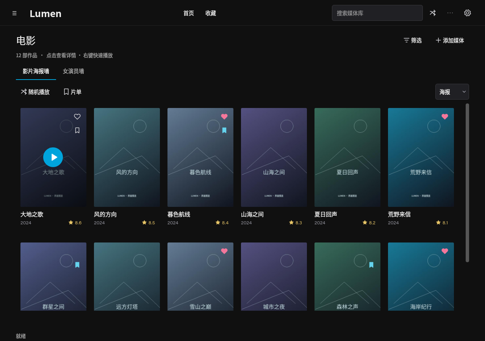
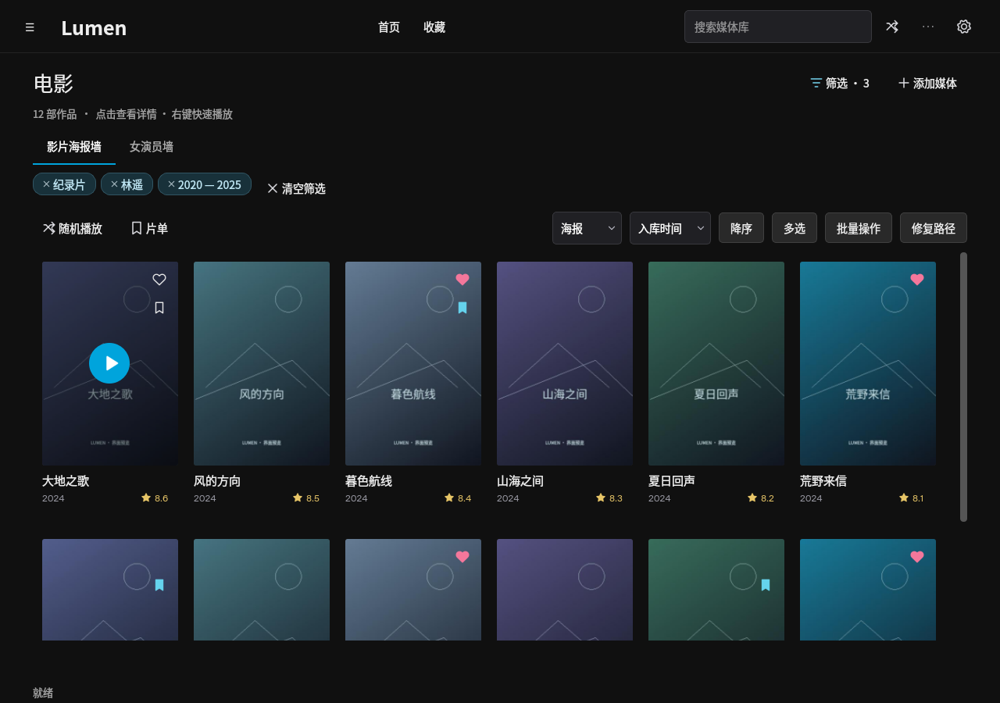
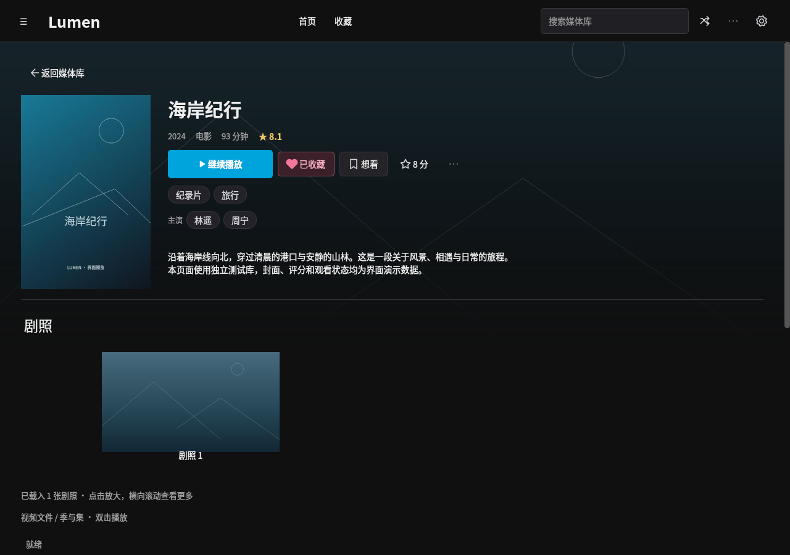
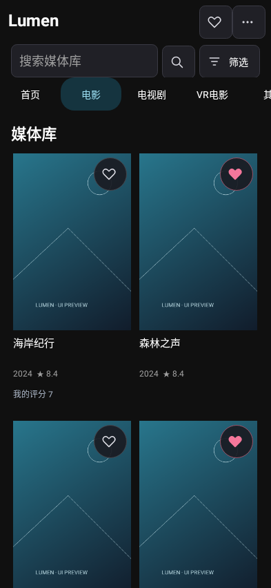
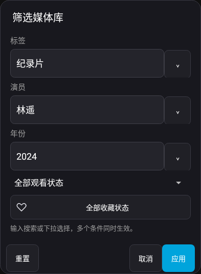
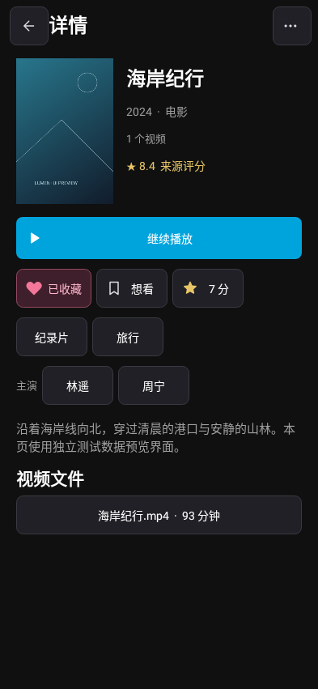

# Lumen · 私人光影库

Windows 本地影音管理软件：真实文件扫描与播放、电影/整部电视剧/VR 电影/其他目录、插件刮削、安全整理、完整候选随机队列、个人评分与统计、女演员墙、可解释推荐和新片发现。无需云账号。

采用 PySide6 + libmpv GPU 播放内核 + SQLite，提供 Qt Multimedia 兼容播放模式。所有页面读取本地真实数据，空库不伪造影片、评分或观影记录。优先站点插件为用户指定的 TVmaze。

## 软件界面

以下 PC 图片来自实际运行的 Qt 程序（Linux 云环境），使用独立示例资料库；封面、标题和评分仅用于展示界面，不写入用户资料库。截图对应当前源码，历史安装包的界面可能不同。

### PC 媒体库



| 已选筛选条件 | 影片详情 |
| --- | --- |
| [](docs/screenshots/ui-filter-results.png) | [](docs/screenshots/ui-detail.png) |

[查看 PC 筛选侧面板](docs/screenshots/ui-filters.png) · [查看小窗口详情布局](docs/screenshots/ui-detail-compact.png)

### Android 界面预览

以下是实际 Activity 在 Android 原生图形测试环境中的绘制结果，使用示例服务端数据，尚非手机实机截图。Windows / Android 真机显示仍需验收。

| 媒体库 | 筛选 | 详情 |
| --- | --- | --- |
| [](docs/screenshots/ui-android-library.png) | [](docs/screenshots/ui-android-filters.png) | [](docs/screenshots/ui-android-detail.png) |

更多交互说明与截图复现方法见 [UI 设计说明](docs/ui-design.md)。

### 0.4.8 播放中评分与偏好

PC 和手机播放器直接评分、收藏、确认喜欢 / 不喜欢，普通播放、全屏与 VR 均可使用；保存不打断视频。喜欢与收藏独立，旧数据保留。[更新说明](docs/releases/0.4.8.md) · [PC 播放截图](docs/screenshots/player-personal-pc.png) · [安卓播放截图](docs/screenshots/player-personal-android.png) · [VR 控件截图](docs/screenshots/player-personal-android-vr.png)。

### 0.4.7 基础功能补全

新增两端排序、三态观看筛选、手动标记、按季选集、倍速、连播开关、可编辑队列和全屏剧照。PC 增加多选批量操作、仅移出媒体库与校验后目录重定位；Android 增加共享智能片单及返回列表保留位置。封面个人操作去掉圆形背景。[更新说明](docs/releases/0.4.7.md) · [设计对照核查](docs/basic-feature-audit.md) · [按季选集截图](docs/screenshots/catalog-season-pc.png) · [队列编辑截图](docs/screenshots/catalog-queue-pc.png)。

### 0.4.5 VR 与手机遥控更新

修复 VR 大幅抬头接近或越过 90° 时左右旋转；手机播放页增加上一 / 下个视频按钮，蓝牙切换同步生效，支持 VR 多文件、相邻作品与随机队列。[播放说明](docs/android-vr.md)。

手机新增控制 Windows 关机：PC 设置 → 局域网 / Android 中允许手机关机后，在手机电脑遥控页确认；倒计时 15 秒，两端均可取消，使用正常关机，不强制结束程序。[0.4.5 更新说明](docs/releases/0.4.5.md)。

保留导入、全屏、书签与内存优化、Android GitHub 更新、VR 灵敏度 / 平滑 / 反转、目录监控、播放诊断、字幕调节、截图书签、手机播放遥控和后台队列。[媒体工具](docs/media-tools.md) · [稳定性修复与截图](docs/pc-stability-and-updates.md)。

### 0.4.6 PC 更新

电视剧改为按文件夹归集，缺少季集编号也可导入；修复任务与诊断窗口的大报告卡顿和点击剧照时的预览闪烁，并新增 PC GitHub 更新检测、后台下载及空闲时自动安装。入口、截图与验证范围见 [本轮 PC 修复](docs/pc-maintenance.md)。这批修改已包含在 0.4.6 Release；target / Actions 保留同一产物。历史 0.4.5 不包含这些更改。

## 下载

[**Lumen 0.4.7 · Windows + Android Release**](https://github.com/sleeper-lfy/my-jellyfin/releases/tag/v0.4.7) 已发布，两端安装包均已从公开链接重新下载并通过 SHA-256 校验：

- [Windows x64 完整安装包：Lumen-Setup-x64.exe](https://github.com/sleeper-lfy/my-jellyfin/releases/download/v0.4.7/Lumen-Setup-x64.exe)，Windows 10/11 x64，直接安装，无需分片合并。
- [Android 完整安装包：Lumen-android-debug.apk](https://github.com/sleeper-lfy/my-jellyfin/releases/download/v0.4.7/Lumen-android-debug.apk)，Android 8.0+，0.4.7 / versionCode 10，与上一版签名一致，可覆盖安装。
- [target 安装包备份及校验记录](target/README.md)：完整 APK、同一 Windows EXE 的校验分片和合并脚本。Release 同时提供 SHA-256 文件。

[0.4.7 更新说明](docs/releases/0.4.7.md) · [功能与设计对照](docs/basic-feature-audit.md)。Windows 219 项测试与安装 / 启动 / 卸载验证、Android 55 项测试和 lint 通过。普通推送只验证源码；仅明确请求时打包或发布。源码可通过 **Code → Download ZIP** 获取。

下载资源的默认目录、HTTP 下载后自动入库及外部磁力工具设置见 [下载与影视入库](docs/downloads.md)。

## Windows 安装与启动

提供 [EXE 安装包构建与下载说明](docs/windows-installer.md)。[0.4.7 安装包](target/README.md)已通过 Windows 构建与安装验证并保存到 target / Actions；以下为源码启动方式。

需要 Windows 10/11 x64、Python 3.12、FFmpeg 与 FFprobe（两个程序加入 PATH）。可通过已安装的 Winget 获取 Python/FFmpeg，或从各项目官方渠道安装；保持包签名/校验验证。

```powershell
cd my-jellyfin
py -3.12 -m venv .venv
.venv\Scripts\python -m pip install -r requirements.lock
.venv\Scripts\python -m pip install --no-deps -e .
.venv\Scripts\python -m lumen
```

也可运行 `scripts/start-windows.ps1`。默认数据目录 `%LOCALAPPDATA%\Lumen`；`--data-dir D:\MyLumenData` 可自定义。`LUMEN_DATA_DIR` 环境变量也可覆盖。相同目录使用单实例锁。

## 实际使用

1. 点击导入或拖入一个文件夹，选择电影/电视剧/其他；扫描所有子目录，默认引用原文件。先快速读取 NFO 和海报入库，时长及缺失缩略图后台补充；扫描中可直接退出，已完成记录保留，再次扫描会跳过未变化文件。电视剧推荐文件名 `剧名.S01E01.mkv`，也支持 `剧名/Season 1/01 标题.mp4`，未识别的季集会记录失败原因。
2. 点击卡片在主窗口查看详情，点击标签或演员直接筛选媒体库。海报／缩略图可切换，卡片显示来源评分、个人评分和喜欢状态。播放器左右按钮及键盘方向键每次快进／回退 10 秒，空格暂停／继续；齿轮设置可选内嵌字幕和音轨；自动读取同名外挂 SRT/ASS/SSA/VTT，也可手选。字幕转换保留文本和时间，不承诺完整 ASS 特效渲染。
3. 设置 → 插件 → 安装 `plugins/tvmaze`，检查声明的域名后启用。关键词搜索或粘贴 TVmaze 详情页，确认候选再入库；影片来源按钮可打开浏览器。
4. 设置 → 导入规则，可指定分区自动刮削插件和整理目标。**保存带目标的规则需要确认，之后唯一匹配成功会移动原文件。** 未匹配/多候选进入任务列表；也可在详情中手动整理并查看文件计划。
5. 全局搜索或组合筛选后创建随机队列。全部匹配对象等概率洗牌，不局限当前显示页；整部电视剧算一个对象。上一/下一作品与剧内下一集分开，队列结束停止，重启可继续。
6. 电影/电视剧可评 1–10 分、收藏、想看或不感兴趣。电影和 VR 电影的未知演员性别默认按女性展示，已明确的男性资料不变；电视剧保留原值。均分排除未评分、同作品多版本只计一次。
7. 发现页刷新插件数据，按来源/分类筛选；插件提供剧照和下载链接时可在详情中查看并手动下载。HTTP 视频下载到指定目录后自动关联影片资料，磁力可交给外部下载工具。定期刷新仅在程序运行时执行，详见 [下载与影视入库](docs/downloads.md)。
8. 统计页展示实际观看时间、严格超过 600 秒的有效播放、日周月年趋势、偏好和年报。暂停、缓冲与跳转不增加观看时间。

## 从 Jellyfin 接手本地媒体库

导入原有文件夹即可读取同名 NFO、本地海报、影片资料及季集；已入库目录再次导入可补读 NFO。原视频和 NFO 保留，不要求重新联网刮削。详情见 [Jellyfin 迁移说明](docs/jellyfin-migration.md)。

## Android 局域网客户端

已增加原生 Android 客户端（Android 8.0+）。在电脑端设置 → 局域网 / Android 中启用服务，手机填写电脑局域网地址与访问密钥，即可浏览媒体、播放视频并同步观看记录。安卓播放器使用 LibVLC，支持硬件优先、软件解码兜底和手动切换，可选择音轨与字幕。安装、构建和连接说明见 [Android 文档](docs/android.md)。

## 数据安全

- 文件操作不静默覆盖，跨卷先复制、同步并 SHA-256 校验，成功后才删除源文件。失败在任务页重试。
- 元数据字段可锁定。个人评分和站点评分独立。
- 设置中支持数据库备份和恢复；恢复前自动备份当前库。数据库备份不包含视频、海报或插件；完整迁移须另外备份数据目录与视频。
- JS 插件在独立进程中运行，无文件/进程/网络原生 API；宿主提供限定域名、预算和代理的 GET 请求。不是任意 Python 插件执行器。

## 测试与打包

```powershell
.venv\Scripts\python -m pytest -q
./scripts/build-windows.ps1
```

Windows 打包输出 `dist\Lumen\Lumen.exe` 和 `dist\Lumen-windows-x64.zip`，使用 onedir 保留可替换的动态库。包含 FFmpeg/FFprobe 和插件示例，必须在 Windows 上构建。`.github/workflows/windows.yml` 定义手动测试、打包和 artifact；0.4.7 已完成 Windows 安装器验证并发布双端 Release。

Linux 云开发：

```bash
bash scripts/setup-cloud.sh
QT_QPA_PLATFORM=offscreen .venv/bin/python -m pytest -q
QT_QPA_PLATFORM=offscreen .venv/bin/python -m lumen --smoke --data-dir .local/smoke
# 有桌面显示时：
.venv/bin/python -m lumen
```

Linux 运行可验证核心逻辑、真实解码和 UI，但不代表 Windows 音频、驱动和安装兼容性。当前验证范围和限制见 [进展记录](docs/progress.md)。

## 文档

[需求](docs/requirements.md) · [技术选型](docs/architecture-decision.md) · [架构](docs/architecture.md) · [插件开发](docs/plugin-development.md) · [UI 规范](docs/ui-design.md) · [媒体工具](docs/media-tools.md) · [阶段验收](docs/implementation-plan.md) · [第三方许可](THIRD_PARTY_NOTICES.md)

## 0.4.0 播放与媒体资料

Windows 使用 libmpv 原生 GPU 播放，保留 Qt 控制栏，可开启高质量缩放与轻度锐化。新增 VR电影分类，安卓打开该分类自动进入 VR180 左右 3D；支持标准／鱼眼、单屏／双眼、陀螺仪与立体声。其他分类默认普通播放。

剧照支持插件 `stills`、本地 NFO／extrafanart，以及 tvshow.nfo + 视频同名 NFO 的整剧与单集资料。下载资源列表支持磁力与 HTTP/HTTPS 直链；下载必须由用户点击启动。详见 [插件字段文档](docs/plugin-development.md)、[安卓 VR](docs/android-vr.md) 与 [播放内核说明](docs/mpv-runtime.md)。

Android 0.4.1 改善全屏浮层控制，按视频显示比例自动横竖屏；VR 支持一键回正、双指／按钮缩放，以及蓝牙耳机、遥控器、手柄自定义映射，入口为播放设置 → 蓝牙 / 手柄映射。

0.4.1 同时修复 PC 剧照与发现页资源展示，提供本地 NFO 图片“仅补充缺失／强制覆盖”，网页来源默认用无痕方式打开。大媒体库查询与图片解码放到后台，首页海报行不再拦截普通垂直滚轮。用法见 [NFO 迁移与图片更新](docs/jellyfin-migration.md)。
