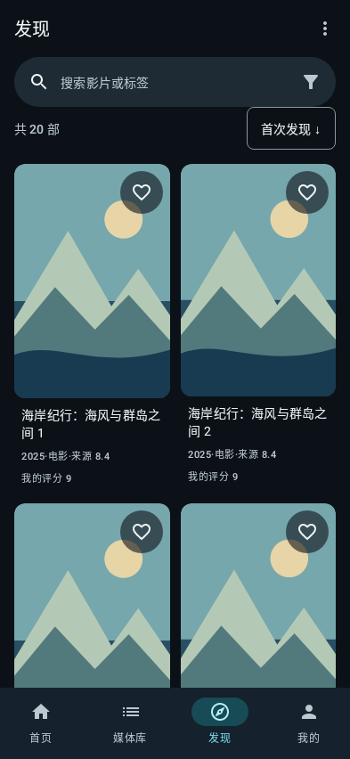
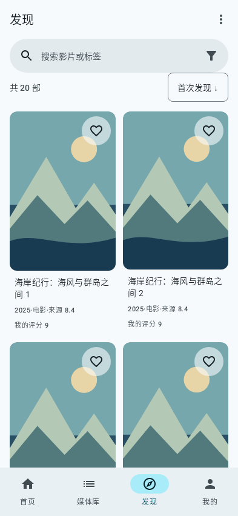
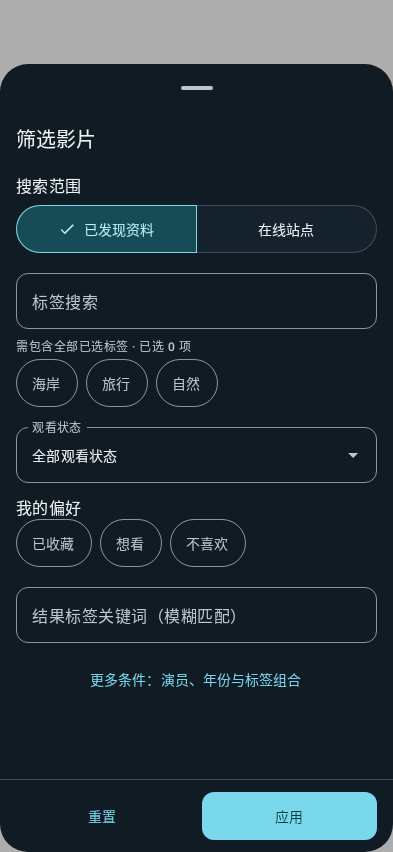
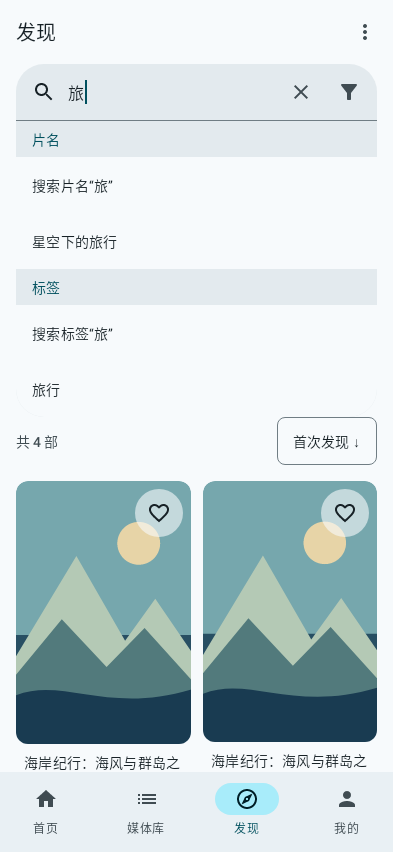

# Android Material 3：发现页迁移

本轮按用户最新规范使用官方 Jetpack Compose Material 3，替代先前 44dp、自绘 View 的发现页方案。现有应用是 Java 原生 View；迁移范围仅为发现页，数据接口保持不变。首页最近入库按补充要求恢复原有统一竖向裁切展示，继续观看仍使用独立缩略图。

## 组件和状态边界

| 文件 | 职责 |
| --- | --- |
| `DiscoveryTheme.kt` | 青蓝 primary 的深浅 `colorScheme`、`typography`、`shapes` 与尺寸 token |
| `DiscoveryComposeHost.kt` | Java 到 Compose 的生命周期、不可变状态快照、图片和 Snackbar 边界 |
| `DiscoveryCoordinator.java` | 既有 HTTP 请求、搜索身份、筛选、排序、分页、收藏与导航状态 |
| `DiscoveryUiState.java` / `DiscoveryCallbacks.java` | 只读展示快照与用户意图，无网络调用进入组件 |
| `DiscoveryScreen.kt` / `DiscoveryComposeSearchBar.kt` | 官方顶栏、搜索、分组建议、刷新、导航和四种页面状态 |
| `FilterChipRow.kt` / `SortMenu.kt` | 横向已选条件、逐个删除、清除与单一排序入口 |
| `MovieCard.kt` / `MovieGrid.kt` | 官方卡片与双列惰性网格、图片加载状态、收藏触控 |
| `FilterBottomSheet.kt` / `DiscoveryFilters.java` | 官方模态抽屉与独立草稿；取消不应用，重置保留搜索范围 |
| `DiscoveryImageLoader.kt` | 复用原鉴权图片下载、共享缓存和有限重试，不引入第二套网络库 |

`MainActivity` 使用官方 `ComponentActivity` 提供 Compose 的 Lifecycle／SavedState owner，继续协调原生页面和详情。发现页启用 edge-to-edge；离开后恢复原页面的系统栏策略。返回分发由官方 dispatcher 协调，让模态抽屉优先关闭，详情往返保留结果范围与滚动位置。

## 视觉规则

- 页面不写颜色数值、任意字号和自建形状；全部引用 `MaterialTheme.colorScheme`、`typography`、`shapes`。色值和字体大小仅在主题定义。普通文本／辅助文本满足 WCAG AA，收藏图标在深浅图片极端叠底下检查非文本对比度。
- 形状使用主题中的小 8dp、中 12dp、大 16dp、超大 28dp；间距使用 4dp 网格，页面左右 16dp，网格横纵 12dp。可点击元素至少 48dp，搜索栏 56dp。
- 顶栏只有“发现”，更多操作归入右侧菜单。单个官方搜索组件展开后提供片名／标签分组建议。下滚收起顶栏与搜索、上滚重新出现，编辑搜索时保持输入可见。
- 已选条件单行横滚，末尾固定清除入口，避免多标签把列表挤没。排序入口合并字段与方向，再点已选字段切换方向。
- 卡片保持 2:3、Crop 和主题 medium 圆角；标题最多两行，副信息一行，图片加载使用基于主题语义色的官方动画 shimmer，失败显示占位，均不改变图片区域。收藏采用统一的 48dp 按钮和半透明语义 surface 底。
- 使用官方 `NavigationBar` 默认 pill 形状，四个目的地保持。`Scaffold`、网格和模态抽屉按 WindowInsets 消费安全区，避免重复叠加整块导航高度。键盘安全区由 Compose Insets 处理。
- 中文文本位于 `discovery_screen_strings.xml`、`discovery_filter_strings.xml` 和 `strings_discovery_controller.xml`。数据中的影片／标签名称保留原值。

## 保留的交互语义

搜索建议使用现有发现和标签接口。提交片名、选择标签仍映射到原检索条件；不增加服务端 OR 搜索接口。片名和标签可组合，包含全部／任一／排除标签、年份、个人评分、演员、观看状态和偏好均通过原有参数传送。修复此前 Android 把年份、评分和全部标签参数置空的遗漏。

在线站点的原搜索片名／标签／来源与结果二次筛选分别保存。清除结果条件和重置抽屉不隐式切换站点、不丢 `ids` 或运行中的搜索任务；修改来源／站点标签才发起新搜索。来源读取失败时保留原来源，不自动扩大到全部站点。后台任务状态、失败重试、保存片单、随机队列和手机队列均保留。收藏确认同步当前列表与详情，旧的详情响应不会在返回时撤销成功收藏；随后手动修改的收藏与评分优先于较早的响应。

组件提供深浅 `@Preview`；实际截图来自 Compose／Robolectric 原生绘制及虚构媒体，不使用调试彩框或用户私人图片。测试覆盖真实组件点击、草稿隔离、模态取消、分页、状态转换、安全区与键盘，不能替代真实设备操作验收。

## 播放与缩略图的独立修正

手机图片选择尊重 PC 明确设置的缩略图、有效来源封面和对应 NFO 缩略图，不再把历史 `works.thumbnail` 列一概当海报。多文件电视剧／Fans 仍按当前文件选择，继续拒绝海报回退和缓存路径越界。

视频转发器增加当前会话的 16MiB 有界读缓存，复用已经接收的重叠区间，不预读额外内容、不持久化，退出释放。缓存不足从准确缺口继续上游，保持 Range／HEAD／未知长度、鉴权和拖动取消语义。纯缓存响应不占断线监视队列，防止资源饱和造成额外重试。诊断区分解码器 Range、电脑请求和缓存供给。

277 次相邻区间的受控重放中，电脑往返从 278 次降为 1 次，响应逐字节一致。这只证明该访问模式下减少传输开销：桌面 VLC 合成样本未复现手机的 277 次请求；JNI 模式也已由用户确认仍卡顿。prefetch 阈值对照没有实质改善，未修改默认解码／缓冲策略。小米 15 实际 HEVC 4K 流畅度仍未确认，不宣称已根治。受控样本、计数与实测边界见 [传输验证记录](validation/range-cache-0.4.17.json)。

## 实际原生截图

截图由可执行的 Compose UI 测试绘制，示例图片为项目内的虚构自然海报。它们验证组件布局，不能代替小米 15 真机效果。

| 深色发现页 | 浅色发现页 |
| --- | --- |
|  |  |

| 标签筛选抽屉 | 片名 / 标签分组建议 |
| --- | --- |
|  |  |

[查看列表末行安全区](screenshots/material3-0.4.17/discovery-compose-dark-bottom.png) · [加载骨架](screenshots/material3-0.4.17/discovery-compose-loading.png) · [无结果](screenshots/material3-0.4.17/discovery-compose-empty.png) · [错误重试](screenshots/material3-0.4.17/discovery-compose-error.png)。

[320dp / 1.5 倍字号](screenshots/material3-0.4.17/discovery-compose-narrow-large-text.png) · [大字号末行](screenshots/material3-0.4.17/discovery-compose-narrow-large-text-bottom.png)。窄屏测试同时验证实际可点击的筛选／排序区域至少 48dp、数量与排序不重叠，以及筛选抽屉的真实打开和应用。
