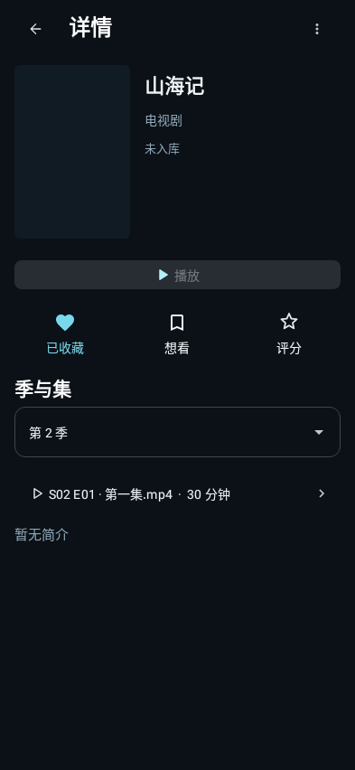

# Android 选集与随机播放修复（0.4.24）

电视剧详情的“季与集”使用现有 Material 下拉组件，可选全部季、特别篇和各季。选季后只显示对应文件，在本次浏览中旋转屏幕、收藏后刷新或从播放器返回仍保留该季；不同媒体库独立记忆。点击单集传递对应的作品、文件与媒体库，不使用其他正在读取的详情的编号。

图片由实际 Activity 在 Robolectric 原生图形环境绘制，使用虚构作品、空封面和隔离设置，不是手机实机截图。

播放器“选集 / 文件”标明当前文件，并展示资料中已有的季集编号。选择另一集时，先保存原文件设置与进度、结束原播放会话、释放解码器和连接，再载入所选文件；重复点选正在播放的集不会重新开始。载入中显示提示，失败可重试。自动进入下一集或离开播放器时，旧选集窗口关闭。

全局随机和当前列表随机都有可取消的加载面板。全局随机使用全部本地作品，不受当前分类、筛选或页码限制；当前列表随机沿用该列表全部匹配结果与媒体库范围。两者均按作品随机，一部电视剧作为一个对象，集内继续沿用选集与连播逻辑。

随机生成失败时可重试同一范围；没有可播放文件时提示空结果。取消、失败和空结果不会替换已有手机队列，也不会改动电脑队列。旧电脑端缺少所需接口时会提示升级。PC 0.4.24 对全局队列生成只读取必要文件信息，仍检查文件存在与目录范围，建议两端同步升级。

源码验证及公开发布记录会随版本发布更新。自动回归覆盖真实 Activity 事件、受控 HTTP 和实际文件检查；不包含手机原生 LibVLC 硬件解码验收。小米 15 的 HEVC 4K 流畅度仍需设备验证。
