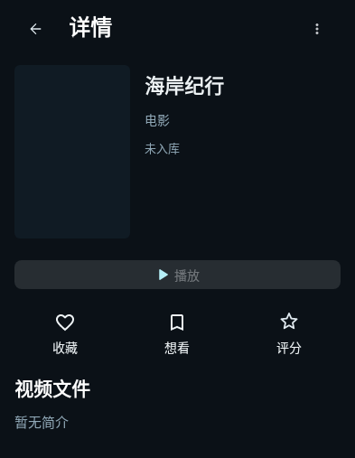
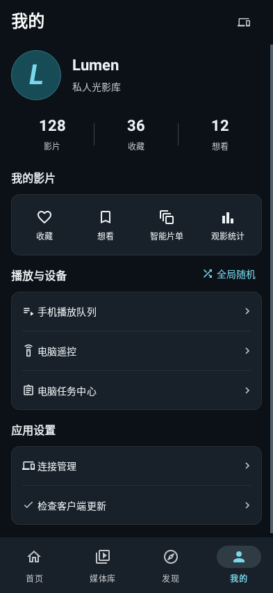
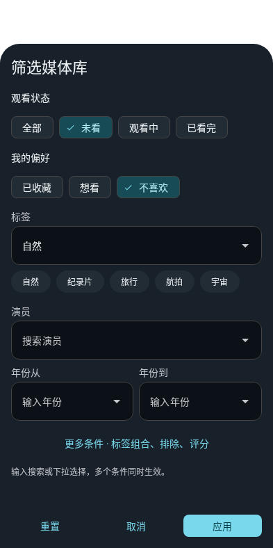
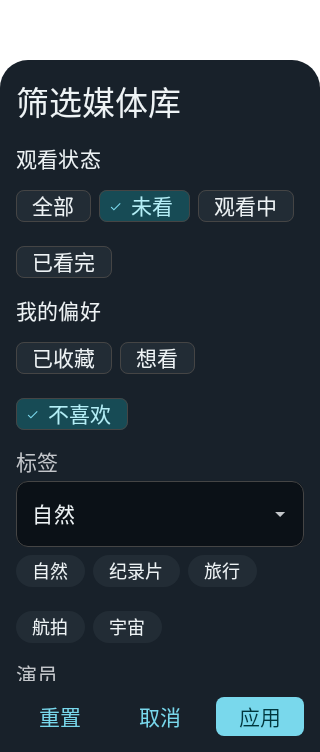
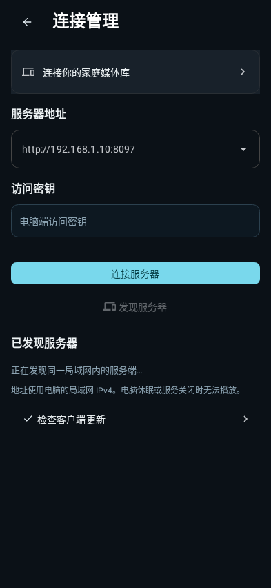
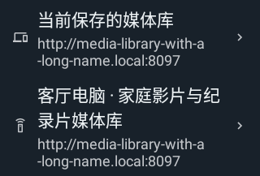

# Android 对齐与 Material 3 控件修复

本页记录已在 0.4.21 Preview 1 发布的界面修复。Java View 页面可以直接使用 Material 3 官方组件，无需先重写成 Compose；本轮修正详情、我的、媒体库筛选、连接管理及两端更新渠道。

- 详情的收藏、想看、评分共用竖向图标操作样式，图标和文字居中，评分及个人状态更新后保持布局。
- “我的”数量与说明文字使用同宽、居中的列；保留真实数量、快捷入口和动态更新。
- 筛选及服务器地址使用官方 `TextInputLayout` 与 `MaterialAutoCompleteTextView`，沿用 M3 OutlinedBox 样式及内置下拉图标、16dp 文本内边距和至少 48dp 图标触控区。
- 媒体库筛选改用官方 `BottomSheetDialog`、`ChipGroup` 与 Filter Chip。表单滚动，操作栏固定；保留互斥选择、组合条件、年份与评分验证、片单和全部既有接口。重置仅修改草稿，应用才生效。评分下拉提供 0–10，并可手动输入。
- 底部面板处理系统栏、屏幕侧边安全区和键盘；较旧 Android 使用窗口缩放，避免重复加上键盘高度。
- 当前保存的媒体库与已发现服务器使用共享文本列，名称及地址具有一致内边距、间距、截断和整行点击。
- Java Material 3 深／浅主题的 32 个语义颜色与 Compose 主题一致，应用生产主题继续采用已确认的深色配色；本轮不改变系统主题设置。
- 手机与 PC 更新渠道可直接打开 GitHub Releases；识别到明确候选版本时打开对应版本页面，未识别时打开发布列表。检查、下载、签名与安装流程保持原有规则。

这些修改沿用项目已有 Material 依赖，没有新增组件库。其余旧页面的系统弹窗尚未整体迁移，不能将本轮描述为整个 Android 应用已经完成 M3 重构。

## 实际组件截图

截图由 Robolectric 原生绘制生成，使用虚构片名、数量和合成图片，不含用户的真实媒体或连接密钥；它们不替代真机触控与键盘验收。

| 详情操作 | 我的页面 | 媒体库筛选 |
| --- | --- | --- |
|  |  |  |

| 320dp／150% 字体筛选 | 连接管理 | 320dp／150% 字体连接列表 |
| --- | --- | --- |
|  |  |  |

## 验证

Android 全量 **263 项测试通过，零失败／错误／跳过**；修正导航栏 API 兼容接口后，**7 项 Android 8／现代系统面板及主题回归通过**，lint 零错误／89 项警告，`assembleDebug` 成功。PC 更新 UI／流程 **14 项通过、1 项 PowerShell 环境检查跳过**。

[详情大字体](screenshots/android-ui-alignment/detail-actions-font1.5.png) · [数量列大字体](screenshots/android-ui-alignment/mine-totals-font1.5.png)。

验证结果与源码文件、截图摘要记录在 [本轮验证](validation/android-ui-alignment.json)。

[0.4.21 Preview 1 安装包](https://github.com/sleeper-lfy/my-jellyfin/releases/tag/v0.4.21-preview.1) · [公开发布验证](validation/preview-0.4.21-1.json)。
