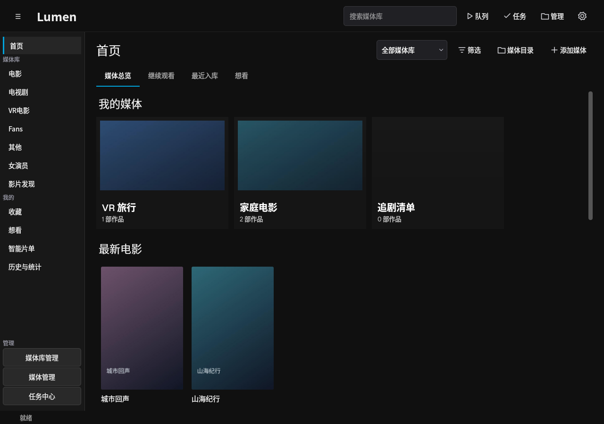
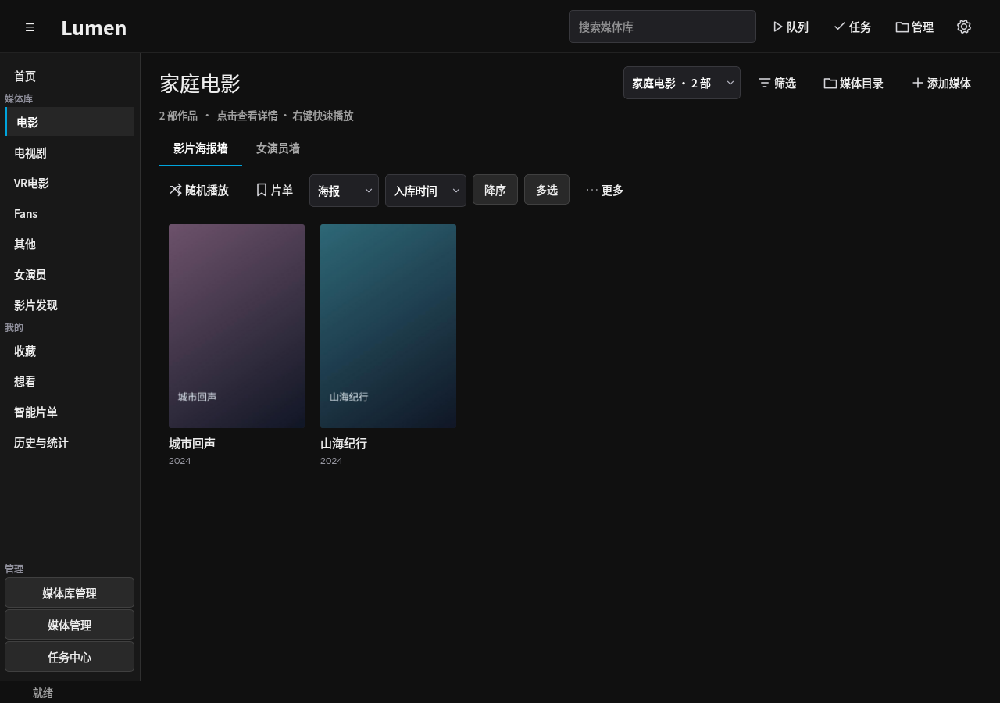
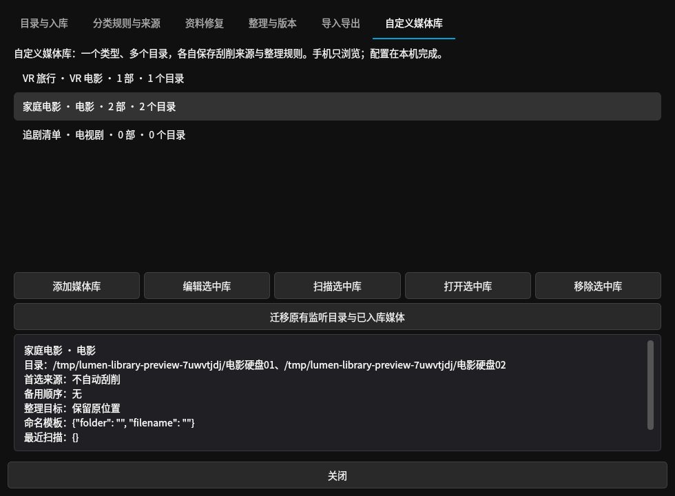
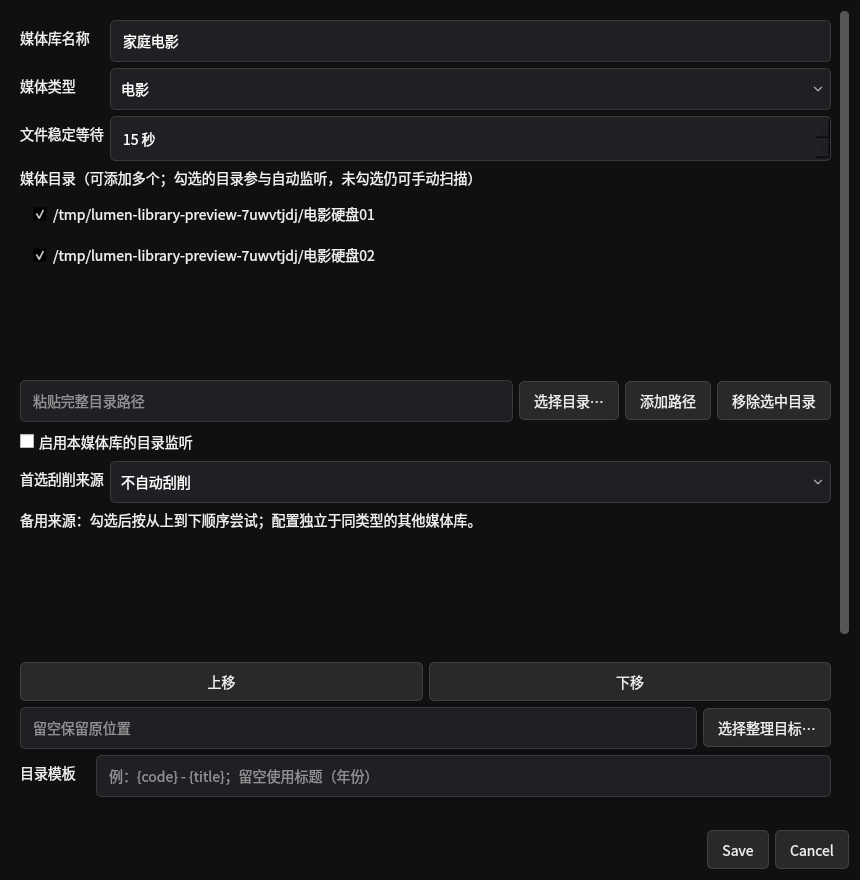

# 自定义媒体库（0.4.22）

一个媒体库对应一个固定类型，可包含多个目录。PC 负责创建、目录监听、刮削来源和整理规则；Android 连接同一台 PC 后选择媒体库浏览、筛选和播放，不提供媒体库配置入口。

## 创建与使用

1. PC 左侧 **媒体库管理**，或顶部 **管理 → 自定义媒体库**，点击 **添加媒体库**。
2. 输入名称，选择电影、电视剧、VR 电影、Fans 或其他类型。创建后类型固定；需要另一种类型时新建媒体库。
3. 添加一个或多个完整目录。可直接粘贴路径，也可使用系统目录选择器。勾选参与自动监听的目录，再启用本库监听；文件稳定等待默认 15 秒，可设 5–600 秒。
4. 为本库选择首选刮削来源、勾选并排列备用来源，按需填写整理目标和目录／文件名模板。来源列表沿用现有已安装并启用的插件及按需引擎。不选择来源表示不自动联网刮削；不设整理目标表示保留原位置。
5. 保存时可选择立即扫描。扫描、自动匹配和整理进入现有后台任务队列。PC 首页“我的媒体”和上方媒体库选择器可直接打开此库。
6. 手机端首页／媒体库出现可横向滚动的媒体库选择栏；点击库名后，列表、筛选选项、详情、继续播放及当前列表随机均遵循此库范围。“全部媒体库”和全局随机仍覆盖全部本地媒体。

电影、电视剧、VR 电影支持自动刮削和整理。Fans／其他类型保留现有扫描归组方式，不增加不受支持的自动刮削与移动。

## 规则与文件归属

- 每库保存自己的首选、备用顺序、稳定等待、整理目标和命名模板，不随之后的分类默认设置改变。
- 监听开关可按库或按目录暂停；手动扫描仍检查全部已配置目录。移除某个目录停止后续监听，已经入库的文件归属保留。
- 同一源目录及其父子目录不能重复配置，也不能与其他库的源目录或整理目标交叉。已有旧监听目录须先迁移或移除旧配置，避免两套任务处理同一批文件。
- 不同库可共用整理目标，已有文件靠明确的文件归属识别；共享目标中的未知文件不会猜测归属。仍使用原有文件计划、校验复制和禁止覆盖规则。
- 自动整理移动路径后保留原来的库归属、文件 ID、进度和书签。磁盘离线或文件缺失只报告，不自动删除资料。
- 保存规则本身不移动已有文件。已有排队任务保留入队时的规则快照；修改后的规则用于后续新任务。手动整理可从对应库的详情进入，预览本库文件和命名计划后确认。
- 自动刮削的唯一匹配、待确认、回退、重试逻辑保持不变。单片手动刮削优先选当前库的来源；确认一库的匹配不会同时放行其他库待确认的整理任务。
- 当前列表随机保留库范围；主动把其他库的影片加入现有播放队列后，队列转为混合范围，仍可连续播放。

**资料共享边界：** 沿用现有作品去重模型。同一作品在不同库中有多个文件时，作品资料、评分、喜欢／收藏和想看共享；各文件的归属、位置、观看进度和自动整理任务分别保存。不同库的来源都可能更新这份共享作品资料。本次不增加按库分开的用户账号或元数据副本。

## 原有目录如何迁移

原配置不会在升级时自动改写。在媒体库管理点击 **迁移原有监听目录与已入库媒体**，确认后：

- 按类型与实际生效的首选、备用、目标、命名及稳定等待分组；规则相同的多个目录合为一个库，不同规则分别创建。
- 已暂停的目录保持暂停；已经整理到唯一对应目标的文件一并收归该库。共享目标或其他未分配文件按类型放入“原有…（未配置监听）”，不擅自分配。
- 完整成功后清空旧监听列表；出错整体回滚，原配置保留。迁移不刮削、不移动视频、不改个人状态。迁移生成的名称和规则均可再编辑。

移除媒体库只移除配置和文件归属，视频、作品资料与观看记录保留在全部媒体。库内“仅移出媒体库”只解除该作品在当前库的归属；再次手动扫描可能重新加入。永久删除本地文件仍需核对路径并确认，操作范围限当前库文件。

## 实际界面

截图来自独立合成资料库：PC 为 Linux 中运行的实际 Qt 控件；Android 为实际 Activity 的 Robolectric 原生绘制。不是 Windows／手机实机验收，不包含用户媒体。

| PC 首页媒体库 | PC 库内浏览 |
| --- | --- |
|  |  |

| PC 管理 | PC 多目录配置 |
| --- | --- |
|  |  |

[查看独立命名配置](screenshots/media-libraries/pc-config-rules.png) · [Android 选中媒体库](screenshots/media-libraries/android-named-library-393.png) · [320dp 横向选择栏](screenshots/media-libraries/android-library-selector-320.png)

## 实现与验证

PC 沿用 PySide6、现有目录选择器、规则编辑器与后台任务；Android 沿用 Java 原生 Material 3 Chip，不增加依赖。新表 `media_libraries` 保存库配置，`media_library_files` 保存文件归属。数据库升级至 schema 3，升级前备份；旧备份在临时副本迁移后可恢复。局域网只增加只读查询能力，不返回目录或刮削配置；管理写入接口拒绝手机请求。库范围用于组织和浏览，不是逐库访问权限系统。

验证包含多目录配置、规则隔离、真实临时文件整理、旧规则分组迁移、备份恢复、库内文件操作、PC 导航与随机队列、认证只读 API、Android 选择／筛选／详情／播放与重建状态。详见[本轮验证记录](validation/media-libraries-source.json)。Windows 原生目录选择器及手机跨端联调仍需真机确认。

已在 [0.4.22 Preview 1](https://github.com/sleeper-lfy/my-jellyfin/releases/tag/v0.4.22-preview.1) 发布双端安装包，Android versionCode 41；建议 PC 与手机同时升级。[公开附件验证](validation/preview-0.4.22-1.json)。
