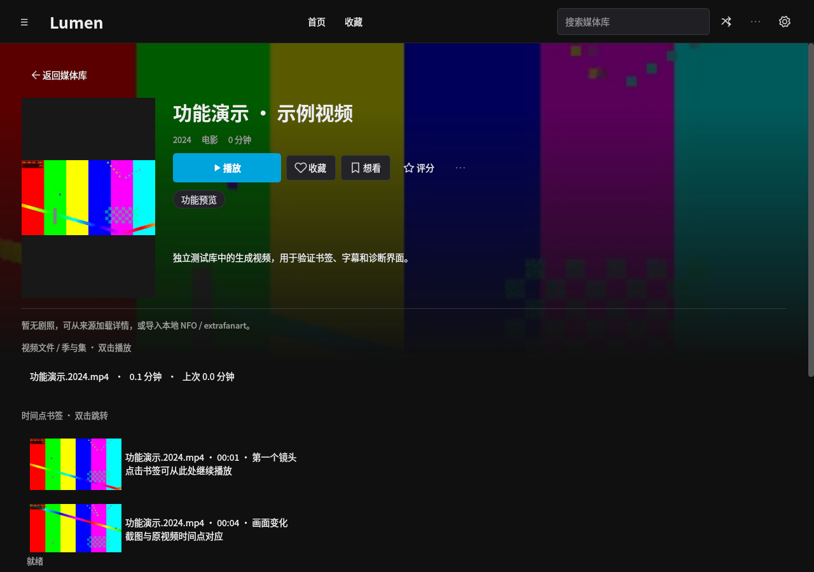
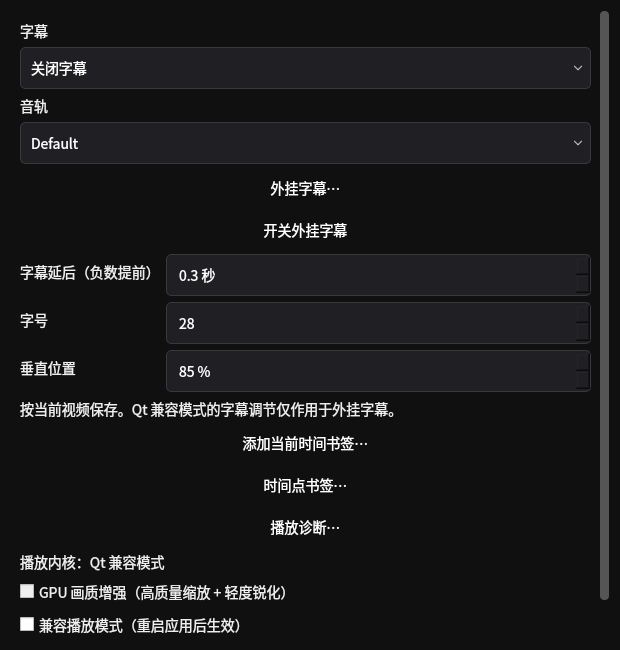

# 媒体管理与播放工具（0.4.3）

本页功能在 0.4.2 发布之后加入源码，已包含在 [target 的 0.4.3 安装包](../target/README.md) 中。0.4.3 本次仅打包、不发布 Release；历史 Release 的 0.4.2 EXE / APK 不包含这些更新。

## 使用入口

| 功能 | PC | Android |
| --- | --- | --- |
| 目录增量监控 | 顶部更多 → 目录监控与媒体库体检；也可从设置 → 通用 / 数据安全进入 | 由电脑服务端执行 |
| 播放诊断 | 播放器齿轮 → 播放诊断 | 播放设置 → 播放诊断 |
| 字幕延时、字号、位置 | 播放器齿轮 | 播放设置 → 字幕同步与样式 |
| 时间点书签与截图 | 播放器齿轮 → 添加当前时间书签 / 时间点书签；详情页双击书签跳转 | 播放设置 → 添加 / 查看时间点书签；详情页点击书签播放 |
| 按视频记忆 VR 设置 | 不适用 | VR 设置与播放中的回正、缩放、转向操作 |
| 手机遥控电脑 | 设置 → 局域网 / Android → 启用手机遥控 | 菜单 → 电脑遥控；影片详情 → 在电脑上播放 |
| 媒体库体检 | 目录监控与媒体库体检 → 媒体库体检 | 由电脑执行，可在电脑导出报告 |
| 后台任务队列 | 任务中心；设置 → 通用 / 数据安全 → 后台任务并发上限 | 手机提交的电脑下载任务使用同一并发额度 |

## 目录监控与体检

添加目录、选择媒体分类并保存。程序运行期间每 10 秒在后台检查一次；任务繁忙或暂停时顺延。默认等待文件及 NFO / 图片稳定 15 秒，至少两次检查一致后才入库，可调整为 5–600 秒。视频仍在写入、同名 NFO 或图片正在变化时继续等待。监控目录不可相互包含，避免重复扫描。

已有文件只更新发生变化的内容，后续后台任务补充时长和缺失缩略图。监控使用本地资料，不执行自动联网匹配和文件整理；不移动或删除源文件。重扫保留个人评分、收藏、观看记录及资料锁。移动硬盘离线时保留原资料，恢复连接后继续检查。

体检针对已登记的媒体文件生成报告：区分根目录离线和目录内文件缺失，检查路径范围、海报、损坏 NFO；重复文件依据库中已有的完整 SHA-256，快速抽样指纹不作为重复结论。报告可导出 JSON。体检不修复、不删除视频或数据库媒体记录。

## 播放诊断与字幕

诊断窗口持续刷新，并支持复制文本。PC 的 libmpv 显示解码器、视频尺寸、硬件解码、丢帧和缓冲等实际可取得的数据；Qt 兼容模式只显示该内核提供的数据。Android 显示 LibVLC 编码、分辨率、帧率、解码 / 显示 / 丢帧及读取速率。LibVLC 接口未暴露实际硬解状态时，只显示所选解码策略，不将“自动”当成硬解成功。复制内容不包含文件路径和访问密钥。

字幕延时范围 ±600 秒，正数延后、负数提前；字号 12–64，垂直位置 5%–95%。设置按视频文件保存，切换视频时恢复。PC libmpv 可调内嵌及外挂字幕；Qt 兼容模式的调节只作用于应用渲染的外挂字幕。Android 字号或位置变化时重建解码器并恢复位置与暂停状态；带自身样式的 ASS 字幕可能覆盖字体或位置设置。

## 时间点书签

为当前播放位置填写名称与备注，保存后在电脑后台通过 FFmpeg 生成对应帧截图。截图失败时保留时间书签，可从列表重新生成；视频离线时仍能查看已保存的文字和截图。PC 详情与 Android 详情显示书签，选择后从指定位置播放，播放器列表也能直接跳转或删除。每个视频最多 500 个书签。

添加书签和生成截图本身不增加播放时长、观看次数或已看标记。截图是数据目录中的缓存，数据库备份包含书签文字和时间；完整迁移还需复制缓存与原视频。

## Android VR 与手机遥控

每个视频分别记忆标准 / 鱼眼、单屏 / 双眼、左右眼交换、头部追踪、横滑调进度、视场角，以及手动调整的水平和垂直视角。头部传感器的实时姿态不持久化；重新打开仍以当时的设备姿态建立参考，回正按钮可重设。VR 电影分类继续默认使用 VR180 左右 3D，其他分类保持正常播放。

遥控须先在电脑启用局域网服务和手机遥控，再用同一服务地址及密钥连接 Android。可以在手机选择影片让电脑播放，控制播放 / 暂停、前后 10 秒、进度、音量、静音、音轨和字幕；手机显示电脑的当前片名和播放状态。

命令通过有界队列转到电脑 GUI 线程执行，过期命令拒绝，手机读取实际执行结果。遥控默认关闭；关闭后不再接受控制。它控制当前运行的 Lumen 播放器。

## 后台任务

后台操作进入队列，界面显示阶段、当前路径、数量或字节进度以及处理速率。并发上限为 1–3，默认 1；PC 后台处理、局域网下载和服务端书签截图共享额度。任务历史写入在独立线程合并，避免界面等待批量导入的 SQLite 写锁。

任务中心可暂停 / 继续队列、停止单项或停止整队列。暂停和取消在操作的安全检查点生效；正在等待网络读取或外部进程时需要等该阶段返回。已完成内容保留。导入失败可只重试失败路径，取消导入可继续扫描；下载失败可重新下载并入库，文件整理可从原记录恢复。

本次运行中保存的通用后台操作可直接重试。重启后导入、下载、媒体补充和整理等持久化任务仍可从原记录恢复或重试，通用临时操作需重新发起。HTTP 重试会重新下载，不支持断点续传；不自动重放刮削候选选择或启动外部磁力下载。异常退出遗留的通用后台状态会标为已停止。

旧数据库自动补充新表。恢复尚无播放偏好和书签表的旧版备份时，在临时副本中迁移并校验，原备份文件保持原样。

## 页面预览与验证

以下为实际 Qt 页面截图，来自 Linux 云环境中的独立测试库与生成视频。

| 书签详情 | 字幕设置 |
| --- | --- |
|  |  |

[目录监控](screenshots/tools-monitor-pc.png) · [只读体检](screenshots/tools-health-pc.png) · [播放诊断](screenshots/tools-diagnostics-pc.png)

复现：`QT_QPA_PLATFORM=offscreen .venv/bin/python scripts/capture-media-tools-preview.py`。

Python 完整回归 179 项通过、1 项默认原生环境检查跳过；另行运行真实 libmpv 图形检查，验证 GPU 视频与 Qt 控制层叠加、字幕参数在全屏切换后保留、定位和重开。最终布局调整后另有 10 项界面检查通过。Android 33 项单元 / 界面测试及 lint 通过，包含每视频 VR 设置、字幕输入与遥控鉴权。

Windows 显卡 / Explorer 任务栏及 Android 实际手机、蓝牙和头显体验仍需硬件验收。没有增加 Android 离线观看，也没有增加 2D 视频转 VR 观看。
