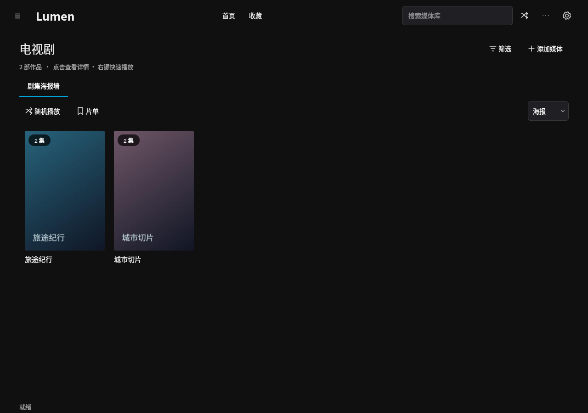
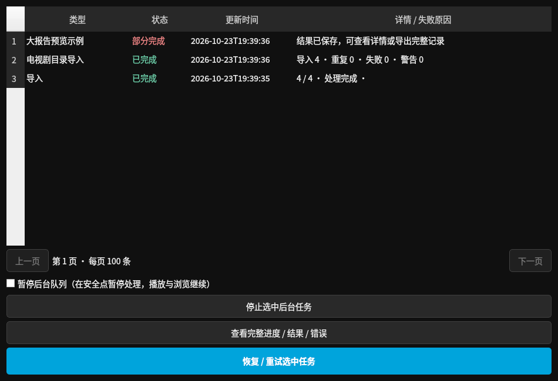
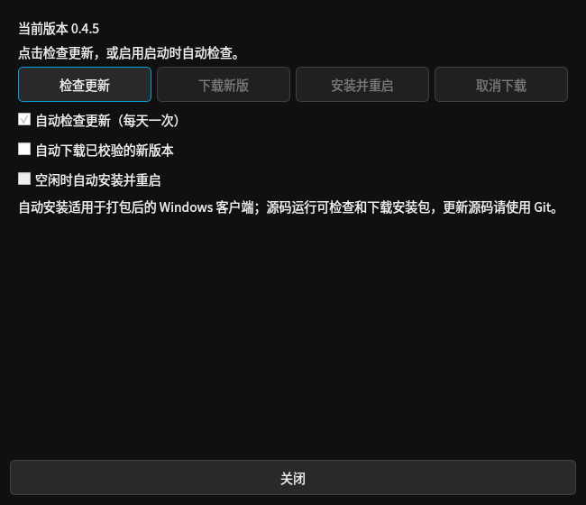
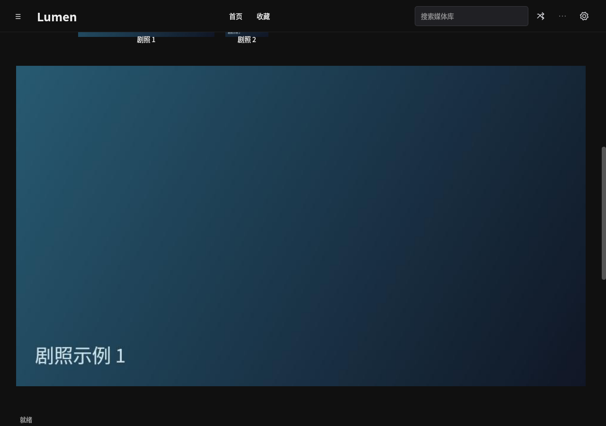

# 电视剧目录、任务窗口、PC 更新与剧照修复

本页修改已包含在 [0.4.6 Windows + Android Release](https://github.com/sleeper-lfy/my-jellyfin/releases/tag/v0.4.6)，target / Actions 保留同一安装包；旧 0.4.5 EXE 不包含本页功能。下载见 [0.4.6 安装包说明](releases/0.4.6.md)，实际结果见 target/release-status.json。

## 按文件夹导入电视剧

导入时选择“电视剧”：同一文件夹内的视频归为一部剧，不再强制要求 S01E01。缺少整剧 NFO 时以文件夹名称显示剧名；有 tvshow.nfo 时读取其中的整剧资料。同名视频 NFO 的标题、简介、图片和季集号归到对应单集。

季集号优先使用有效 NFO，再识别 S01E01、1x02、OVA 1、OAD 2、Episode 3、EP04、第1巻、第2话等文件名标记。无编号的视频也可入库，默认第一季，按文件名自然排序分配未占用的集数；已有自动编号尽量保留，新添文件不使旧集数整体变动。Season 1 / Season 2 等目录及 tvshow.nfo 整剧目录继续按整部剧归集。

不同目录的同名剧默认分别管理；明确相同的整剧外部 ID 仍可关联，冲突标识会提示核对。重新导入不会复制已入库文件，重复数量表示现有记录被保留；旧版本报错的文件可直接重新导入。旧版在同一目录内拆开的电视剧可重新归集，保留文件 ID、进度、书签和单集图片资料。

## 任务与诊断

任务窗口独立显示并在后台读取，每页 100 条；上一页 / 下一页可浏览旧记录。表格只显示有界摘要，固定行高，长路径省略显示；刷新保留选择和滚动。取消、暂停、重试功能继续可用。

点击“查看完整进度 / 结果 / 错误”按需在后台读详情。大报告显示预览，可“导出完整 JSON”，导出按块写入且使用同一数据库快照，避免把大结果完整铺进表格或在主线程解析。关闭任务窗口不停止正常导入；退出程序时会协调停止读取工作。

## PC 更新检测与自动更新

入口为主界面右上角工具菜单 → **检查软件更新**，或 **设置 → 软件更新**。

- 自动检查默认开启，Windows 安装版在启动后后台检查，并按每天一次的频率检查；长时间运行时每小时判断是否到期。
- “自动下载已校验的新版本”和“空闲时自动安装并重启”可分别开启。自动安装同时启用自动下载；关闭自动安装会保留已下载文件。
- 手动检查、下载、取消下载及“安装并重启”都在更新页面。检测与下载不占用导入队列，界面保持可操作。

更新优先从本仓库 GitHub 最新稳定 Release 获取完整 Windows EXE；API 不可用时使用 target 的成功发布状态与匹配的 Windows 清单定位同一 Release。只接收 GitHub HTTPS 地址，不向 GitHub 发送局域网访问密钥。安装包流式下载，核对大小、SHA-256 和 PE 格式，错误 / 取消会清理临时文件。

自动安装等待导入、排队任务、LAN 下载、PC 播放及最近活动的手机播放会话结束。准备安装后再次检查空闲状态和自动安装选项，避免抢占新开始的任务。先备份资料库至数据目录 `updates/library-before-<版本>-<时间>.sqlite`，退出进程，再由独立更新助手校验安装包并执行普通 Inno 升级，沿用当前安装位置和自定义数据目录，完成后重新启动。助手不强制结束应用，不自动重启 Windows。安装失败保留记录，并在可能时重新启动原程序；不会自动反复重试同一失败版本。

已下载更新可在重开程序后恢复校验，无需重复下载。安装日志及结果位于数据目录的 `updates/update-install.log`、`updates/update-result.json`。自动安装用于打包后的 Windows 客户端；源码运行支持检查 / 下载，源码升级仍使用 Git。

## 点击剧照

放大预览仍在详情页内，不弹出新窗口。首次展开后预览区域保持固定高度、图片保持比例；下一张解码完成前保留上一张，重复点击同一张不清空图片或重复滚动。海报、背景和剧照只在图像或显示尺寸变化时更新，背景裁切缓存限制在实际显示区域大小。

上述截图来自实际运行的 Qt 控件，使用独立生成的示例资料库；拍摄环境为 Linux 云环境，更新页面按源码运行显示安装限制。复现命令：`QT_QPA_PLATFORM=offscreen .venv/bin/python scripts/capture-pc-maintenance-preview.py`。

## 验证范围

回归包含原样结构的 OVA / 第1巻 文件名、无编号自然排序、NFO 优先、季目录、同名不同目录、部分失败重试、旧拆分记录合并后书签 / 进度保留，以及不重复读取未变化的 NFO。

任务窗口测试让读取线程主动等待，确认主线程计时器继续运行；验证大结果预览、分页与完整 JSON 导出。剧照测试延迟返回下一张图片，确认旧图片、预览尺寸及滚动位置不变。

PC 更新测试覆盖 API 回退、版本比较、源地址与重定向、安装包大小 / 哈希 / PE 校验、下载取消清理、缓存恢复、失败版本不自动重试、日检间隔、GUI 响应、任务 / 手机播放 / LAN 下载 / 忙锁等待、备份与助手启动请求。Windows CI 另外只解析 PowerShell 助手语法，不实际运行安装。云端测试使用替代安装器，没有安装或重启用户电脑；真实 Windows 原位升级与显卡上的闪烁表现仍需设备验收。

源码 `4a2b7bf` 的 [Windows 验证](https://github.com/sleeper-lfy/my-jellyfin/actions/runs/40013620883) 与 [Android 验证](https://github.com/sleeper-lfy/my-jellyfin/actions/runs/40013620836) 均已通过；Windows 包含更新助手的 PowerShell 解析检查。本地完整回归为 209 项通过、2 项依赖环境检查跳过。还用新更新器实际校验了已公开下载的 0.4.5 EXE（201246119 字节），大小、SHA-256 和 PE 检查通过。上述验证没有执行更新安装，也没有生成新安装包或发布 Release。
