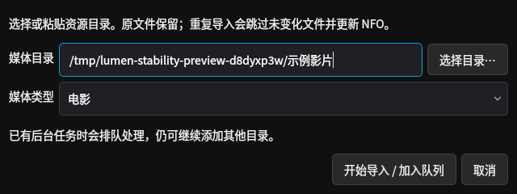
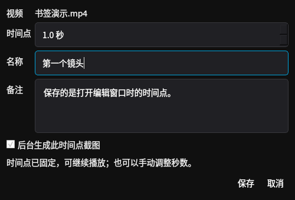
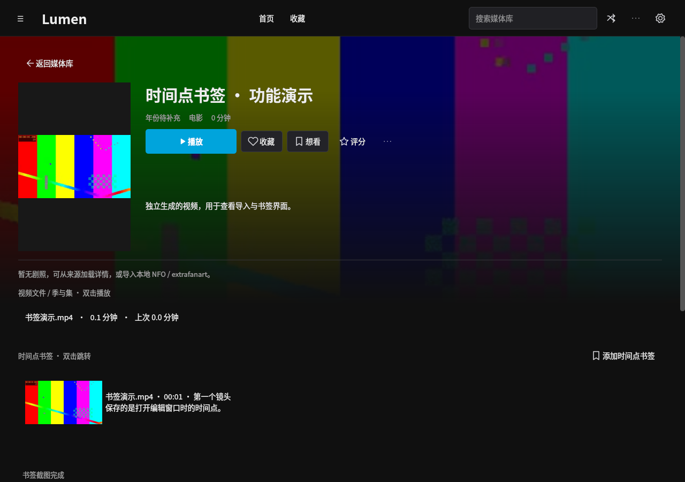

# 导入、书签、内存与 Android 更新修复（0.4.4）

这些修改已包含在 [0.4.4 Windows + Android Release](https://github.com/sleeper-lfy/my-jellyfin/releases/tag/v0.4.4)。[更新说明](releases/0.4.4.md) 和 target/release-status.json 记录交付结果；旧 0.4.3 安装包不包含本页更新。

## PC 导入和刷新

- 底部任务区固定占位，进度条、计数和停止按钮在同一行；任务开始、结束和任务切换时不改变页面高度。长路径单行省略，悬停查看全文。
- 工作线程限制进度通知频率；导入中的媒体库查询放到后台，保持现有页面可操作。海报按 ID 更新，保留选择、滚动位置和已加载数量；首页复用现有分类卡片和横向列表。
- 图片刷新保留旧画面，替代图片解码完成后再替换。后台任务结束不再造成海报集体变空白。
- “添加媒体”统一为可复用的非阻塞窗口，支持粘贴路径、选择目录和分类。目录选择使用 Qt 非原生弹窗，避免 Windows Shell 扩展阻塞；路径访问和导入在工作线程执行，已有任务时排队。同目录可再次导入，跳过未变化文件并补读 NFO。

## PC 全屏

使用 Qt 原有全屏状态切换，保持窗口和视频宿主句柄，正常切换不销毁 mpv 实例、不重新打开视频。只有平台实际更换原生宿主时才恢复播放实例。Windows 保留 Explorer 全屏标记和完整显示器定位；窗口已经覆盖显示器时不重复设置位置，不再反复发送 FRAMECHANGED。

真实 libmpv 图形检查验证了切换前后实例与宿主句柄不变、播放位置连续、字幕设置保留、视频与控制层可见。Linux Xvfb 不能代表所有 Windows 驱动 / Explorer 情况，仍需实际设备检查过渡画面。

## 时间点书签

PC 播放器底部和 Android 播放页顶部都有明确的“书签”入口。PC 还可按 Ctrl+B；详情页即使尚无书签也显示添加入口和空状态。

PC 编辑器在打开时固定时间点，名称、备注和秒数在同一窗口填写，保存时不会改用填写结束后的播放时间；可选择后台生成截图。保存后立即更新详情，截图完成后刷新缩略图。列表支持跳转、重截图和删除。关闭的临时窗口会释放，不长期挂在播放器上。

| 添加书签 | 详情中的书签 |
| --- | --- |
|  |  |

[查看播放器中的书签按钮](screenshots/fix-player-bookmark-pc.png)。截图来自 Linux 中实际运行的 Qt 程序与独立生成视频。

## PC 内存

图片像素缓存上限从 64 MiB 调为 32 MiB，条目上限 256；请求尺寸分档，按屏幕实际缩放比例解码。解码请求最多 32 个，仅允许 2 个解码结果等待 GUI 接收，避免工作线程提前生成大量 QImage 堆在事件队列里。离屏剧照释放图标，大图后台按显示尺寸解码。

海报项只保存显示和交互所需字段，不再重复复制完整 NFO、剧照和每集简介。成功任务立即释放重试闭包，失败任务只保留最近 32 项；首页控件复用。

在相同 Linux 云环境，用 90 条独立合成记录和 90 张生成海报进行六轮相同的首页 / 媒体库切换、滚动及刷新：

| 最后一轮 | 0.4.3 源码 | 修复后 |
| --- | ---: | ---: |
| 进程常驻内存 RSS | 141.6 MiB | 119.2 MiB |
| 图片像素缓存 | 38.2 MiB | 18.6 MiB |

该场景 RSS 减少约 15.8%，修复后后几轮占用趋于稳定；它是界面测试，不包含视频解码内存，不承诺所有设备或影片具有相同结果。原始记录见 [JSON](validation/pc-stability-memory.json)，复现脚本为 `QT_QPA_PLATFORM=offscreen .venv/bin/python scripts/profile-pc-memory.py`；基线为 `b7692cb` 的 src/lumen。

## Android GitHub 更新

连接页面的“检查客户端更新”和媒体库更多菜单中的“检查更新”均可进入，无需连接电脑。手动检查 GitHub 最新稳定 Release 和仓库 target/android-build.json，比较版本及 versionCode；API 不可访问时仍尝试仓库清单。只报告可用的更高版本，不把旧 Release 当更新。

用户点击下载后，以 64 KiB 缓冲流式写入应用缓存，显示进度，支持取消并清理临时文件。文件大小和 SHA-256 校验通过后，还核对包名、版本及与当前应用一致的签名，再提供“安装”。安装由 Android 系统确认；未授权安装应用时引导到本应用的系统授权页面。使用只读、临时授权的 content URI 交付唯一已校验 APK，不暴露其他缓存文件。

GitHub 请求不携带媒体服务器密钥，不关闭 TLS 校验；来源限定为 GitHub HTTPS。下载失败可重新检查 / 下载，不支持断点续传、静默安装或签名变更迁移。target 清单与 APK 更新之间发生版本变化时，校验会拒绝不一致文件。

## Android VR 与蓝牙

旧横屏转换在正常持机姿态附近接近欧拉角俯仰极点，会把抬头误算为水平转动。现在直接从旋转矩阵的视线方向计算朝向，横屏、反向横屏和竖屏使用相同的物理定义：抬头看上方，低头看下方，两个方向不串轴。

播放设置 → VR 设置提供陀螺仪灵敏度 25%–150%、平滑时间 0–150 ms 和“反转陀螺仪上下方向”。单屏默认灵敏度 75%，双眼默认 100%，默认平滑 40 ms；头显建议保持 100% 比例并按设备调整平滑，避免过大延迟。设置按视频保存，并作为之后未配置文件的本机默认值。回正重新建立传感器参考，不持久化实时姿态。

“蓝牙 / 手柄映射”增加“上一集”和“下一集”。默认媒体上一首 / 下一首对应上一集 / 下一集，媒体快退 / 快进和左右方向键仍为前后 10 秒；已有自定义映射优先，必要时恢复默认或重新绑定。切集只在当前电视剧中进行，首末集不越界，不变成切换作品；长按切集不会连续跳过多集。

数值和 Activity 测试覆盖两个横屏方向抬头时水平角度保持不变、上下投影、反转、平滑、回正、蓝牙 MediaSession 路由及实际相邻文件请求；真实传感器、蓝牙设备、头显和 Android 系统安装界面仍需实机验收。
