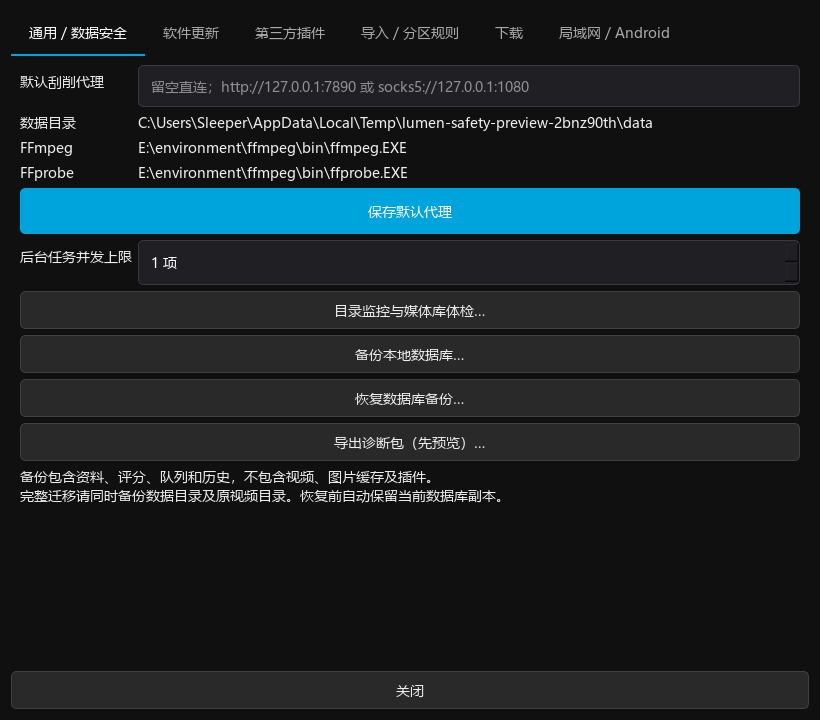
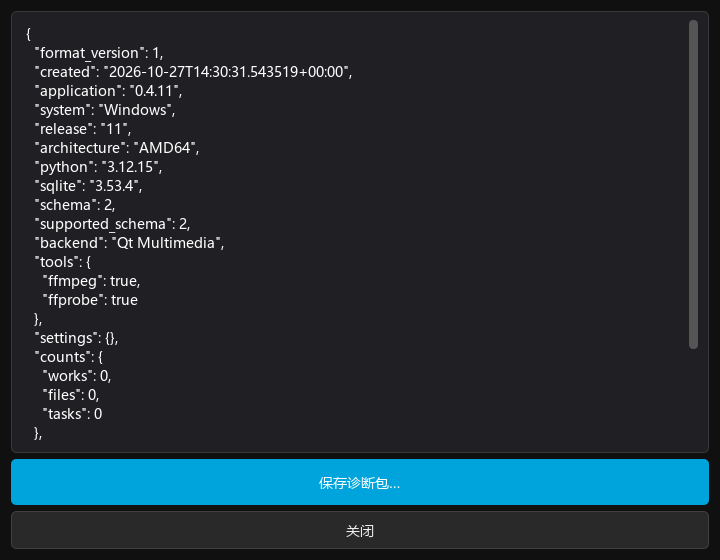

# 媒体库 UI 与交互规范

当前源码沿用 Jellyfin 深色媒体库的布局：近黑背景、青色主操作、透明海报卡片、悬停播放和内嵌详情。此次重新整理筛选、收藏、想看与评分的组件和层级。规范与截图已随 [0.4.9 EXE / APK Release](releases/0.4.9.md) 交付。

## 页面预览

截图来自独立测试数据，示例海报、演员、评分和观看记录不进入用户资料库。

| 页面 | 截图 |
| --- | --- |
| PC 海报墙 | [媒体库](screenshots/ui-library.png) |
| PC 已选筛选 | [可逐项移除的条件](screenshots/ui-filter-results.png) |
| PC 筛选面板 | [右侧面板](screenshots/ui-filters.png) |
| PC 详情 | [1280×900](screenshots/ui-detail.png)、[1024×700](screenshots/ui-detail-compact.png) |
| Android 媒体库 | [手机海报与收藏](screenshots/ui-android-library.png) |
| Android 筛选 | [底部筛选面板](screenshots/ui-android-filters.png) |
| Android 详情 | [海报、播放与个人操作](screenshots/ui-android-detail.png) |

PC 截图直接捕获实际 Qt 页面。Android 截图使用 Robolectric 的原生 Android 图形引擎绘制实际 Activity 和控件，模拟 API 返回示例媒体；采用 Android 13、393×851 的应用区域，不包含系统状态栏。它们不是设计稿，也不代替手机实机验收。

## 统一规则

背景 `#101010`，浮层 `#18181d`，控件采用中性灰；青色 `#00a4dc` 用于播放、应用筛选和焦点。收藏使用粉红心形，想看使用青色书签，来源评分使用金色星标。常用图标采用矢量绘制，不依赖系统字体和 emoji。

0.4.7 及更早版本的“喜欢”沿用 `favorite` 收藏状态。0.4.8 曾使用独立喜欢；0.4.9 按用户确认统一为 `favorite` 一份喜欢／收藏状态，与不喜欢互斥；`liked` 仅保留旧接口兼容别名。想看和评分仍是独立状态。按钮明确显示已收藏 / 已想看，支持再次点击取消；设置项和普通操作不争用主按钮颜色。图标按钮有说明和可访问名称。

## 筛选

PC 从页面右侧打开筛选面板，关闭或 Esc 放弃当前草稿。分类、标签、演员、年份范围、观看状态和仅看收藏作为常用条件；关键词、包含任一 / 排除标签、评分范围和目录限制放在“高级条件”中，已有高级条件时自动展开。内容区域可滚动，“重置”和“应用筛选”固定在底部。

标签、演员和年份支持输入搜索、下拉选择。标签可连续选择多个候选，无须手动输入逗号；已选标签显示为可删除标签。高级标签条件保留“任一”和“排除”的独立语义。重置只清空草稿，应用后才更新媒体库。

媒体库顶部展示已应用的筛选条件和数量，可逐项移除或清空；移除标签不清除演员、年份等其他条件。影片发现也遵循当前条件。

Android 使用底部筛选面板，提供可输入的标签、演员、年份与收藏条件；重置不直接应用，取消保留原筛选。页面顶部的已选标签自动换行，不横向抢占列表滚动。底部面板避让输入法，窄屏内容可滚动。

## 海报和个人操作

海报保持竖向 2:3，缩略图沿用 16:9；标题在图下左对齐，年份和来源评分分列，个人评分单独标明。避免为每张卡片重复展示“未喜欢 / 未评分”。剧集数量放在左上角，播放位置保留底部进度条。

PC 海报悬停显示播放、收藏和想看，已选状态始终可见。收藏 / 想看直接更新卡片，不打开详情、不播放、不重建海报墙，保留滚动位置；在收藏列表取消收藏只移除对应卡片。首页横向媒体行使用相同操作。

封面右上角的个人操作只显示图标，不绘制圆形底色或边框；选中状态沿用心形粉红、书签青色。PC 保留原点击区域，Android 保留至少 48dp 的透明触控区域。

Android 海报提供至少 48dp 的收藏触控区域；海报网格与标签均随可用宽度换行。保存时立即显示选中状态，失败恢复原值并提示。收藏和想看操作完成后不重新加载整页。

## 详情

PC 详情保持内嵌：左侧原比例海报，右侧标题、年份、时长、来源评分和主要操作。播放为主按钮，收藏、想看、个人评分并列；刮削、编辑、整理、合并及 NFO 补图放入“更多”。下载目录管理集中在“下载选项”，避免重复堆放管理按钮。

标签和主演可点击筛选。收藏、想看和个人评分原地更新，保留页面与滚动位置。个人评分通过菜单选择或清除，不再使用数字微调框。不同来源评分与个人评分分开表达。

Android 采用小海报与标题并排的头部，播放按钮和个人操作位于其下；长标题可点击展开，标签与主演分组换行。原有视频列表、剧照和下载入口保留，评分、收藏不会把用户送回页首。

## 自选图片、复制标题与图片大小（2026-10-26，PC 源码）

详情标题支持鼠标拖选、键盘选择及 Ctrl+C，复制完整原文，特殊符号按普通文本显示。海报获得焦点后，左右方向键浏览当前作品的封面、缩略图和剧照；点击封面进入大图，同样支持左右方向键与上一张 / 下一张。浏览图片不会自动更换已保存的海报。

详情提供“选择图片设为海报 / 缩略图”，也可从“更多操作 → 选择海报 / 缩略图”或剧照右键进入。图片候选包括当前封面、自选图片、本地单集缩略图、视频截图与已缓存剧照；没有剧照时仍可选择缩略图作为海报。候选只使用已有本地图片，不在打开选择器时请求联网刮削。

选择用途后提供居中、靠左、靠右裁切预览。海报保存为 2:3，缩略图保存为 16:9；左右指横向图像中保留的区域，纵向不足时按高度居中裁切。保存前仅预览，取消不变更；保存成功后更新详情、媒体库与首页，重启后保留。图片读写失败保留原选择并提示。自选图片独立保存，不覆盖原始图片、NFO 或刮削资料；重新刮削不清除用户选择。“更多操作 → 恢复默认海报 / 缩略图”清除两种自选用途，恢复原图片来源。

媒体库工具栏提供“图片大小”：海报卡片宽度 120–300 逻辑像素（默认 190），缩略图卡片宽度 200–480（默认 280），独立保存并保持比例。详情封面和剧照跟随相应设置；首页横向行同步调整高度。提供恢复默认大小，取消不保存。调整不改变原图分辨率和用途。Windows 系统 DPI 仍由 Qt 缩放。

本节为 Windows 桌面新增交互；Android 暂沿用原布局和图片选择行为。验收需覆盖标题复制、无剧照选择缩略图、三种裁切位置、独立保存两种用途、失败回滚、重启恢复、方向键及尺寸调整后的卡片点击区域。

[选图与靠右裁切预览](screenshots/artwork-selection-pc.png) 来自实际 Qt 窗口，使用隔离资料库和标有 LEFT / CENTER / RIGHT 的合成示例图，不含用户媒体。

VR 电影使用与普通电影相同的刮削插件与候选选择入口。插件返回普通电影资料时，手动匹配、来源刷新和导入自动匹配均保留当前作品的 VR 分类；同来源已有未入库电影条目可归并到当前 VR 作品，来源标识、外部编号及别名归入 VR 分类索引。来源已绑定另一部本地影片、电视剧类型不符或外部编号冲突时仍提示人工核对，不自动合并其他本地影片。

## VR 目录归集与合并搜索（2026-10-26，后续源码）

VR 电影按视频的直接父文件夹归为一部作品，子文件夹各自归集，不将整棵目录树视为同一部电影。没有 NFO 时首次以文件夹命名；有 NFO 时保留资料标题；文件按自然顺序展示，例如 Part1、Part2、Part10。目录绑定独立于标题，刮削改名、换扫描根目录、部分重试和后续补充文件仍归入原作品。相同文件夹名或 NFO 标题出现在不同路径时不据此自动合并。

重新扫描旧 VR 目录可归并同一父文件夹内原本拆开的条目，保留文件 ID、观看进度、书签和个人状态。已经关联多个目录的条目保留显式归并关系；存在需要跨目录吸收的旧拆分条目时提示手动核对。NFO 外部编号冲突仍中止该项并记录错误，不将其他目录静默并入。

“更多操作 → 合并重复作品”使用带搜索框的候选列表，可按名称、别名、作品编号、来源编号和文件路径筛选，空格表示多个条件同时匹配。展示年份、文件数和首个路径，完整路径放在提示中。隐藏的候选不允许提交，无结果时有明确提示；选择后仍确认合并方向。候选读取和数据库合并在后台完成，成功后更新当前详情。电影、VR 电影、电视剧沿用相同入口，同类型限制保留。

Fans 作者合并也提供名称、编号和路径搜索；筛选保留已勾选作者并提示已选数量，避免筛选后误以为勾选已清空。

[合并搜索窗口](screenshots/merge-search-pc.png) 使用隔离示例资料绘制实际 Qt 控件，路径和作品均为示例。

## 手动合并预览与撤销（2026-10-26，后续源码）

影视和 Fans 作者在选择候选后进入“合并预览”，按当前实际合并规则对照当前作品、待并入条目与结果：标题、年份、评分、收藏 / 想看 / 不感兴趣、文件数、来源、演员、标签、简介、海报及锁定字段。当前与结果海报并排显示，完整字段值放在提示中，文件路径可在下方核对。Fans 修改作者名称后的结果也参与预览。预览通过后台事务模拟并回滚，不修改媒体库；取消不生成记录。确认时再次校验相关作品状态，变化后要求重新预览。

确认合并与撤销记录在同一个事务提交；记录随资料库保存，关闭和重启后仍可从“更多操作 → 合并记录 / 撤销”进入。撤销按快照恢复相关作品、来源、名称和外部编号索引、文件归属及图片选择，不回滚整个资料库，不移动原视频。文件 ID、合并后新增的观看进度、书签、播放记录和字幕偏好保留；其他作品的变化不受影响。

合并后若相关资料、图片选择、路径或文件归属发生变化，或原条目编号被重新占用，撤销会提示冲突并保持数据原样。连续多次合并时按逆序撤销；已经撤销的记录不可重复执行。队列仍等于合并后的状态时恢复原队列，否则保留用户后来修改的队列。撤销和合并后同步刷新当前详情及播放器所属作品，不重新加载视频。

本功能为新增的手动合并保存记录；旧版合并及导入中的自动归集没有可追溯快照，不提供虚构的旧记录。预览与撤销均使用后台任务，失败不留下半完成合并。

[实际合并预览窗口](screenshots/merge-preview-pc.png) 使用独立示例资料库和色块海报，展示评分保留、文件数量及海报前后对照。

## 验证与复现

交互测试覆盖收藏与想看点击区域、卡片不误播放 / 不跳页、收藏移除、详情原地保存、评分菜单、多标签连续选择、草稿重置与取消、单项筛选移除、发现条件，以及 1024×700 / 1280×900 / 2560×1080 的 PC 主操作布局。Android 覆盖原地保存、失败回滚、API 26 / 35 标签换行，以及原生控件绘制。

PC 预览只使用临时资料库：

```bash
QT_QPA_PLATFORM=offscreen .venv/bin/python scripts/capture-ui-preview.py
```

Android 预览可在已配置工具的云环境中运行，仅执行测试：

```bash
LUMEN_UI_SCREENSHOTS="$PWD/docs/screenshots" python scripts/build-android-cloud.py --offline :app:testDebugUnitTest --tests net.lumen.media.MediaPreviewTest
```

Windows 实机字体 / DPI，以及 Android 厂商系统、输入法、系统栏和触摸手感仍需实机确认。


## 0.4.7 基础操作

媒体库工具栏提供排序字段、升降序和多选；批量操作针对所选作品，不改变普通点击打开详情的行为。观看状态区分未开始 / 观看中 / 已完成，手动标记与真实统计分离。电视剧详情的季选择只过滤集列表。管理操作明确区分“仅移出媒体库”和“修复路径”，不提供含糊的删除按钮。

PC 全屏剧照保留原比例并支持缩放 / 平移 / 切图；Android 作品和单集图片采用统一全屏图集。队列编辑及连播开关见 [0.4.7](releases/0.4.7.md)。

[按季选集](screenshots/catalog-season-pc.png) · [队列编辑](screenshots/catalog-queue-pc.png)。这两张截图使用隔离示例数据，可通过 `QT_QPA_PLATFORM=offscreen .venv/bin/python scripts/capture-catalog-preview.py` 复现。


## 0.4.9 播放中个人操作

播放器独立个人操作行提供评分、喜欢／收藏、不喜欢。来源评分与个人评分分开；动作不暂停 / 重载视频，保留播放会话和位置。全屏与 Android VR / 横竖屏使用相同入口，低高度屏幕压缩说明文字，保留至少 48dp 的手机按钮触控高度。评分菜单打开时控制栏保持可见，保存失败保持原状态并提示重试。

截图与验证说明见 [0.4.9](releases/0.4.9.md)。


## 数据安全与诊断导出（2026-10-27，PC 源码）

设置 → 通用 / 数据安全提供“导出诊断包（先预览）…”。后台采集后打开只读内容预览，确认保存才选择 ZIP 路径；失败显示提示并保留已有文件。不自动上传。导出范围与脱敏规则见 [数据安全说明](data-safety.md)。






## 剧照点击弹出放大（2026-10-27，PC 源码）

剧照缩略图单击直接打开全屏图片弹窗，从点击的那张开始；不再在详情页下方插入展开图片，也不再显示单独的“全屏浏览剧照”按钮。弹窗使用上一张/下一张按钮或键盘左右方向键切换，首尾循环；再次点击图片区域、按 Esc 或点击关闭退出，详情内容和滚动位置保持不变。滚轮缩放及拖动查看保留，拖动不触发点击关闭。右键选择剧照设为海报/缩略图的入口保留。

## 演员头像交互补充（2026-10-28，PC）

女演员墙工具栏提供“批量获取头像…”入口，可选择来源、范围及是否覆盖；默认仅补齐缺失头像，锁定资料保留。唯一姓名或别名匹配才自动保存，多个候选留待单人确认。后台任务显示进度并支持暂停、停止，完成后报告各类结果。

演员墙显示拖图提示。将一张本地图片拖到指定演员卡片上，目标卡片高亮；松开后后台保存缓存副本并同步关联作品。该手动操作仅替换头像，保留演员身份和锁定状态。详见 [演员头像使用说明](actor-portraits.md)。

## 默认缩略图（2026-10-28，PC）

横向缩略图按以下顺序选择：用户手动指定的缩略图、剧照列表中第一张可用图片、本地 NFO 缩略图、视频自动截帧、作品现有封面。已有自动截帧不再优先于剧照，缺失的图片文件跳过；首页横向卡片共用此规则。自动选择不修改用户设置或原图，后续剧照更新后随页面刷新生效。手动重新截取封面视为明确指定缩略图；恢复默认后重新按剧照优先选择。海报模式保持原规则。

## 刮削海报比例回退（2026-10-30，PC）

刮削并缓存图片时检查海报宽高比，0.55～0.80 视为接近 2:3 的竖图。比例合适时保留来源海报；比例不合适或海报缺失时，从已有剧照列表依次选择第一张符合比例的图片。没有符合比例的竖图时，将第一张可解码剧照居中裁切为 2:3 的独立海报副本，原剧照不变。没有可用剧照则保留现有封面，不强制截帧。

用户手动指定的海报、锁定海报、本地 NFO 海报默认保留；明确强制替换 NFO 图片时才放开 NFO 保护。横向缩略图继续遵循手动指定优先、第一张剧照其次的规则。仅保存搜索条目的延迟图片流程不额外下载整套剧照，此规则在实际刮削并缓存详情图片时执行。
