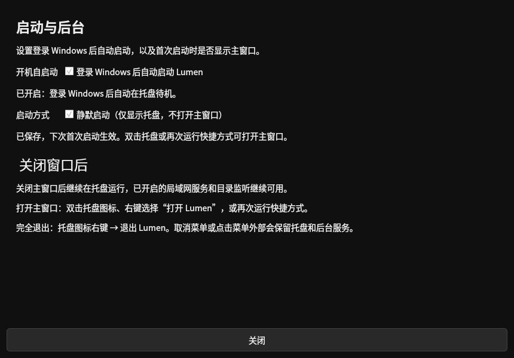

# Windows 托盘与静默启动（0.4.23）

## 托盘右键修复

0.4.22 的托盘菜单在返回零时检查 Win32 LastError，但零同样表示用户取消菜单；菜单内部的消息循环可能留下无关错误。这条路径会结束托盘线程，继而请求关闭后台，表现为右键后图标消失。

0.4.23 将弹出菜单安排到窗口回调以外执行，合并菜单打开期间重复／重入的右键通知。返回零按取消处理；临时创建菜单失败只记录操作错误，保留托盘、局域网与监听，并允许下次重试。选择“退出 Lumen”仍通过后台的安全退出流程处理，取消退出继续保留图标。

专项测试先在旧实现复现四项失败，修复后 14 项托盘测试通过，覆盖取消菜单且残留 Win32 错误、重复通知、菜单失败后重新打开、Explorer 重启和安全退出。

## 设置入口

打开 **设置 → 启动与后台**，此页位于设置第一栏：

- **登录 Windows 后自动启动 Lumen**：读取并设置当前用户 Windows 注册项，登录后先在托盘后台待机。
- **静默启动（仅显示托盘，不打开主窗口）**：独立开关，默认关闭。开启后，下次首次运行快捷方式只启动托盘和已启用的后台服务。
- 双击托盘、右键选择“打开 Lumen”，或在程序已经运行时再次启动快捷方式，均会打开主窗口，避免静默后找不到界面。
- 关闭窗口回到托盘；从托盘菜单选择“退出 Lumen”才完全退出。

静默设置按当前资料库保存，下次首次启动生效，不修改自启动注册项。保存失败时恢复原勾选状态并提示错误。开机自启动始终先在后台待机，不依赖这个开关。

验证静默启动时，先保存设置，再从托盘完全退出，然后重新运行快捷方式；应只出现托盘图标。再次运行或双击托盘应能正常打开界面。

图片为实际 `StartupSettings` Qt 面板在 Linux 预览容器中的绘制，使用临时资料库和模拟 Windows 注册状态，不是 Windows 实机截图。实际 Windows 安装版提供这两个开关；源码运行及非 Windows 环境显示支持范围说明。

## 验证与范围

静默选项在获得后台实例锁并启动服务后读取，读取后关闭数据库连接，不创建 Qt 界面或保留图片缓存。它只影响支持托盘的首次启动；重复启动仍复用原后台并请求打开窗口，显式 `--background` 继续后台启动，CI／验证入口保留原行为。

包含静默选项持久化、失败回退、独立自启动设置、冷启动、重复启动恢复窗口、后台服务和 GUI 兼容回归。源码验证及发布验证记录会随版本发布更新。真实 Windows 隐藏图标栏、鼠标交互与登录启动仍需设备确认。
